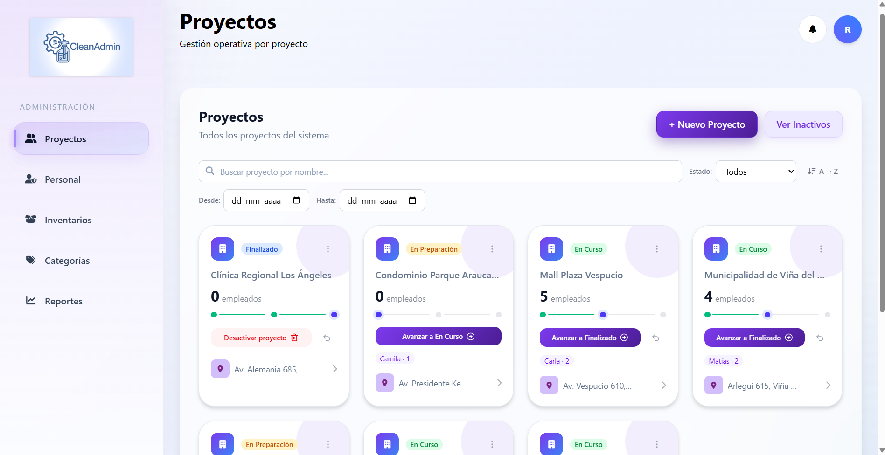
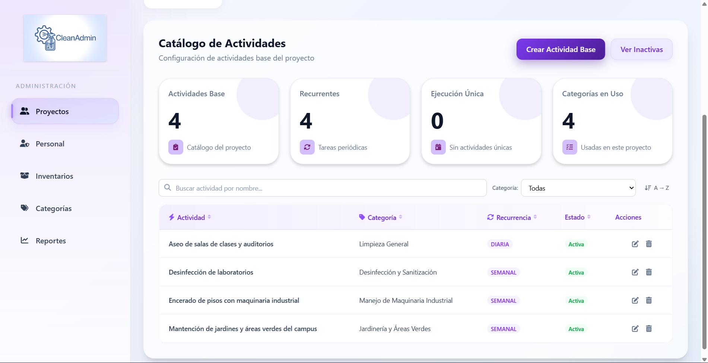
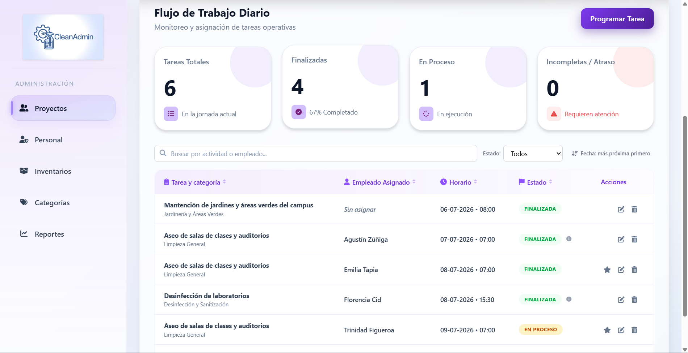
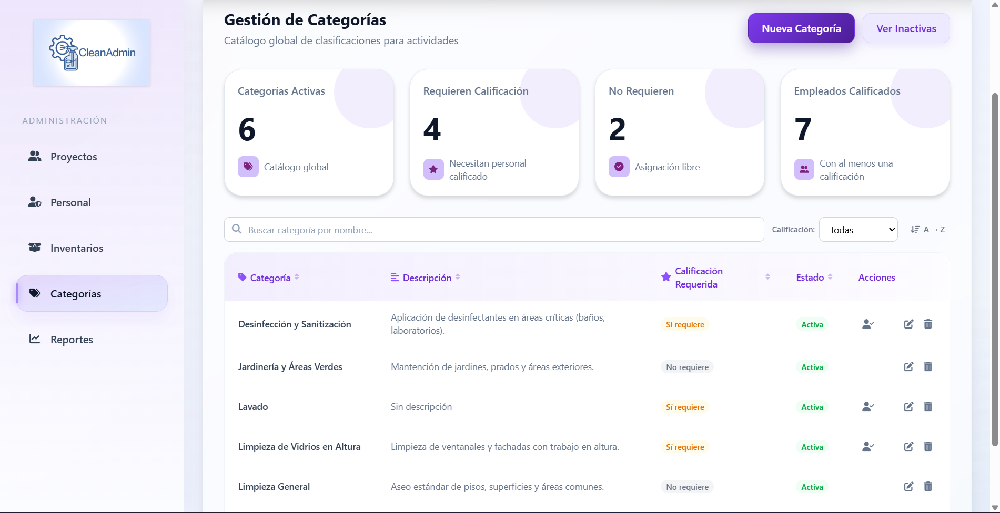
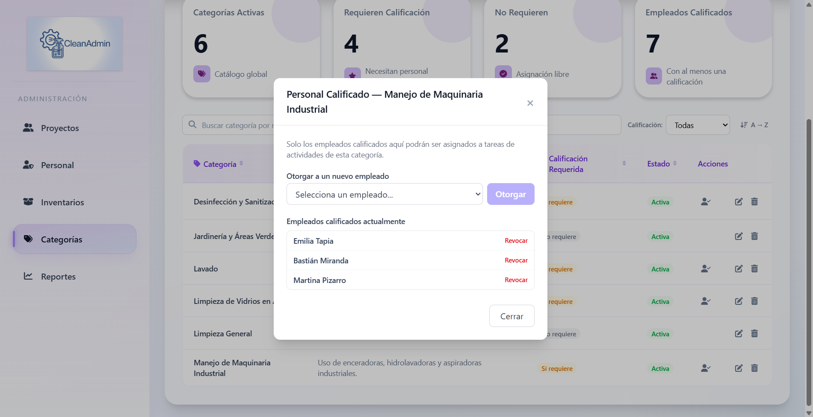
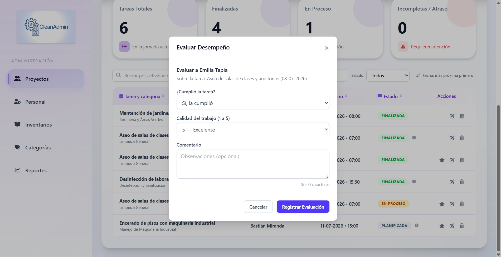

# CleanAdmin

CleanAdmin es una plataforma integral de gestión y administración de operaciones diseñada para optimizar 
la coordinación de recursos humanos, el control de inventario y la planificación de actividades en proyectos operativos.

> Proyecto desarrollado en equipo para el ramo de Ingeniería de Software de Ingeniería Civil en Informática, Universidad del Bío-Bío.



## Mi contribución

*Fernanda Fernández Vergara*

Desarrollé, tanto en el frontend como en el backend, el **Módulo de Actividades y Calificaciones**, que permite planificar el trabajo diario y evaluar al personal:

- **Actividades:** catálogo de las actividades de cada proyecto, clasificadas por categoría.
- **Tareas:** programación de actividades en una fecha y hora, y su asignación y reasignación a los empleados según su disponibilidad.
- **Categorías:** creación y gestión de las categorías con las que se clasifican las actividades.
- **Calificaciones:** matriz de calificaciones de los empleados por categoría, que restringe las tareas complejas a quienes están calificados para realizarlas.
- **Evaluación de desempeño:** registro y seguimiento de la evaluación de los empleados.

En cada módulo implementé el modelo de datos (entidades de TypeORM sobre PostgreSQL), los servicios, controladores y rutas de la API, las validaciones con Joi, y en el frontend los formularios, vistas y notificaciones asociadas.

| Actividades | Tareas | Categorías |
|---|---|---|
|  |  |  |

| Calificaciones | Evaluación de desempeño |
|---|---|
|  |  |

## Módulos del sistema

El sistema funciona a través de tres módulos principales:
###  1. Módulo de RRHH (Asistencia y Turnos)
* **Gestión de Turnos Dinámica:** Creación, edición y asignación de empleados a turnos con validación de solapamiento horario.
* **Asistencia por Token/QR:** Registro automatizado mediante escaneo de códigos QR o tokens alfanuméricos únicos por empleado.

###  2. Módulo de Bodega (Inventario)
* **Control de Stock:** Registro de movimientos (`ENTRADA`, `SALIDA`, `COMPRA`, etc.) con bloqueo estricto de stock negativo.
* **Naturaleza del Item:** Clasificación por control (`CONSUMO` vs `PRESTAMO`) y tipo (`MAQUINARIA`, `HERRAMIENTA`, etc.).

###  3. Módulo de Actividades y Calificaciones
* **Planificación de Tareas:** Programación, asignación y reasignación de actividades diarias a empleados según su disponibilidad horaria.
* **Matriz de Calificaciones:** Restricción de asignación de tareas complejas; solo los empleados calificados en una categoría pueden ejecutarla.

##  Modelo de Roles y Permisos (Jerarquía)

El sistema opera bajo un esquema piramidal de responsabilidades:

1.  **Root:** Administrador absoluto e irrevocable. Puede gestionar a otros administradores.
2.  **Admin:** Gestión global de proyectos, presupuestos de personal y asignación de macro-permisos.
3.  **Supervisor:** Validación, auditoría, aprobación de inventario, creación de categorías y control de múltiples proyectos.
4.  **Encargado:** Operación diaria en terreno, control de asistencia, asignación de tareas diarias y solicitudes de stock.
5.  **Empleado:** Vista de turnos propios, ejecución y reporte de tareas, y registro de asistencia.

## Stack Tecnológico

* **Frontend:** React, Vite, Tailwind CSS, React Router, Recharts
* **Backend:** Node.js, Express, TypeORM, Joi
* **Base de datos:** PostgreSQL
* **Autenticación:** JWT con Passport y contraseñas cifradas con bcrypt

## Cómo ejecutarlo

### Requisitos
* Node.js 18 o superior
* PostgreSQL

### 1. Backend

```bash
cd backend
npm install
```

Crea el archivo `backend/src/config/.env` a partir de `.env.example` y completa los datos de tu base de datos:

```
DB_HOST=localhost
DB_PORT=5432
DB_USERNAME=
PASSWORD=
DATABASE=
HOST=localhost
PORT=3000
JWT_SECRET=
COOKIE_KEY=
```

Carga los datos de prueba y levanta el servidor:

```bash
npm run seed
npm run dev
```

La API queda disponible en `http://localhost:3000/api`.

### 2. Frontend

```bash
cd cleanadmin-app
npm install
npm run dev
```

La aplicación queda disponible en la dirección que indique Vite (por defecto `http://localhost:5173`).

### Usuario de prueba

| Rol | Correo | Contraseña |
|---|---|---|
| Root | admin@cleanadmin.com / 11111111-1 | admin123 |

## Créditos

Proyecto de Ingeniería de Software de la carrera Ingeniería Civil en Informática para la Universidad del Bío-Bío

### Grupo 9 integrado por:

 - Antonia Peña
 - Fernanda Fernández
 - Javiera Cuevas
 - Carlos Bustos
 - Amasis Guzmán
